<div align="center">

<picture>
  <source media="(prefers-color-scheme: dark)" srcset="https://raw.githubusercontent.com/SH1FT-W/flode/main/docs/images/readme-title-dark.webp" />
  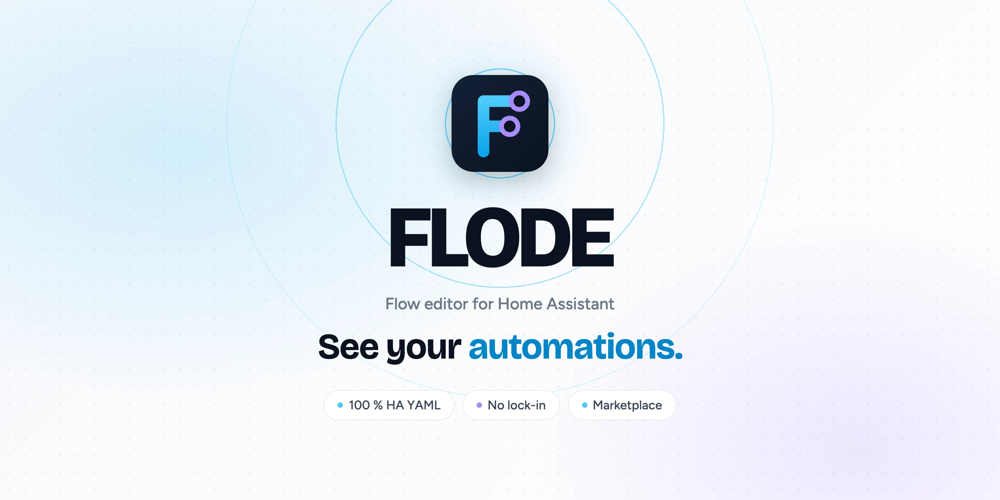
</picture>

[](https://github.com/SH1FT-W/flode/releases/latest)
[](https://www.home-assistant.io)
[](https://hacs.xyz)

<a href="https://sh1ft-w.github.io/flode"><b>Website</b></a>&emsp;<a href="#install">Install</a>&emsp;<a href="#using-it">Using it</a>&emsp;<a href="#ai-help">AI help</a>&emsp;<a href="docs/architecture.md">Internals</a>&emsp;<a href="CHANGELOG.md">Changelog</a>

</div>

<br/>

FLODE shows your Home Assistant automations and scripts as a **flow you can read, test and understand**. Every step opens in Home Assistant's own editor, with the same forms, pickers and dialogs as in Settings. FLODE adds the canvas, so you see how it all connects.

It saves exactly what Home Assistant's own editor would save: plain YAML, no server, no lock-in. Uninstall FLODE and every automation keeps working.

## Your YAML on the canvas

| In Home Assistant | In FLODE |
|:--|:--|
| Triggers, conditions, actions | One card each, with the entity's own icon and live state |
| `choose`, `if` / `then` / `else` | Branches as cards, nested as deep as you like |
| `parallel` | One lane per action, meeting again at the next step |
| `repeat` | One building block; a line drawn back to an earlier card is saved as `repeat` with `until` or `while` |
| A condition right after the triggers | One output only, because Home Assistant stops the run there |
| Steps or fields FLODE cannot model | Kept as written, handed to Home Assistant's editor and saved back unchanged |
| Scripts | The same canvas, with fields and a run button that asks for them |
| Blueprint automations | Opened read-only, with the inputs filled in |

A step that calls an action or entity Home Assistant does not have turns red on the canvas.

<details>
<summary>What a flow looks like in YAML</summary>

```yaml
alias: Evening light
triggers:
  - trigger: sun
    event: sunset
    offset: "-00:15:00"
conditions:
  - condition: state
    entity_id: input_boolean.evening_mode
    state: "on"
actions:
  - action: light.turn_on
    target:
      entity_id: light.bedroom
    data:
      brightness_pct: 40
  - if:
      - condition: state
        entity_id: switch.string_lights
        state: "off"
    then:
      - action: switch.turn_on
        target:
          entity_id: switch.string_lights
mode: restart
```

</details>

**New in 26.10:** parallel actions in lanes of their own, notes, frames and coloured cards, *Run this card* and seven languages. Every change in the [changelog](CHANGELOG.md).

<a id="install"></a>
## Install

[](https://my.home-assistant.io/redirect/hacs_repository/?owner=SH1FT-W&repository=flode&category=integration)

Search for **FLODE** under **Settings > Marketplace** (called HACS before Home Assistant 2026.11), download it and restart Home Assistant. Then add it under **Settings > Devices & services > Add integration > FLODE**. It appears in the sidebar, for admins only.

<details>
<summary>Install by hand</summary>

1. Download `flode.zip` from the [latest release](https://github.com/SH1FT-W/flode/releases/latest).
2. Unzip it into `config/custom_components/flode/` and restart Home Assistant.

</details>

<a id="using-it"></a>
## Using it

The start page is the same table as under Settings, with filters, grouping, labels and bulk actions. Open an automation or script, change it on the canvas and save it back.

| You want | In FLODE |
|:--|:--|
| See what happened | **Runs**: Home Assistant's trace timeline next to the canvas, the path drawn on the cards, the branch that ran marked |
| Try a part | **Run from here** with the data of the last trigger, or **Run this card** for one step, inside branches too |
| Find side effects | **Relations**: conflicting and self-triggering automations, chains, missing entities, and where an entity is used |
| Test a template | **Template workshop** (⌘J): Jinja rendered live by Home Assistant, with the variables of a real run |
| Find any command | **Command palette** (⌘K), right-click menus, and all shortcuts on ? |
| Work on several flows | **Tabs**, each with its own undo, a minimap for big ones, tidy up in one click |
| Bring things in or out | Paste YAML, save as copy, FLODE files, merge several automations into one |

Flows run left to right or top to bottom; the direction is saved with the flow. On touch screens press and hold opens a card's menu, and on a phone the editor slides up as a sheet.

<p align="center">
<picture><source media="(prefers-color-scheme: dark)" srcset="https://raw.githubusercontent.com/SH1FT-W/flode/main/docs/images/flode-runs-dark.png" />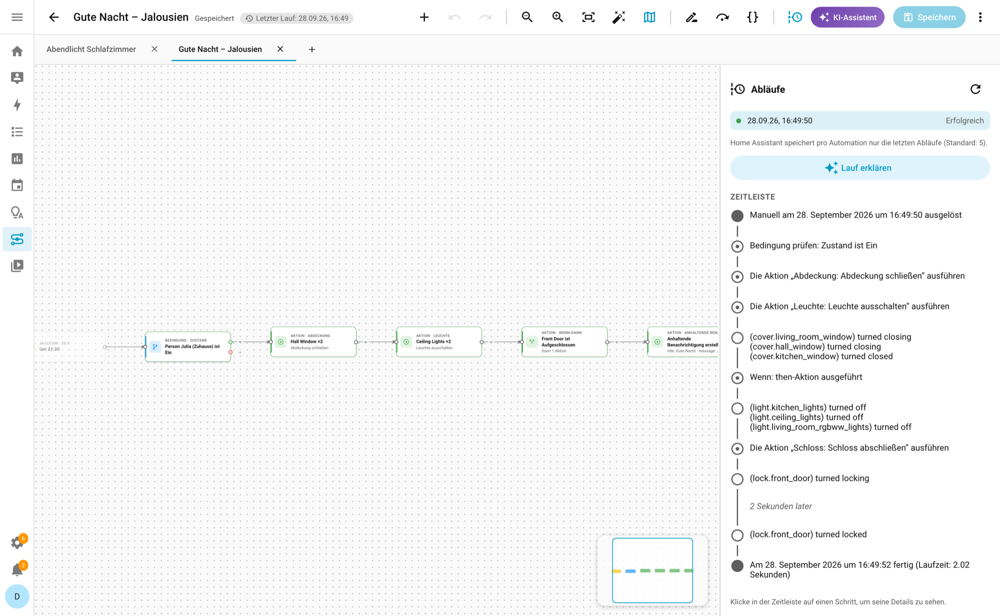</picture>
<picture><source media="(prefers-color-scheme: dark)" srcset="https://raw.githubusercontent.com/SH1FT-W/flode/main/docs/images/flode-relations-dark.png" />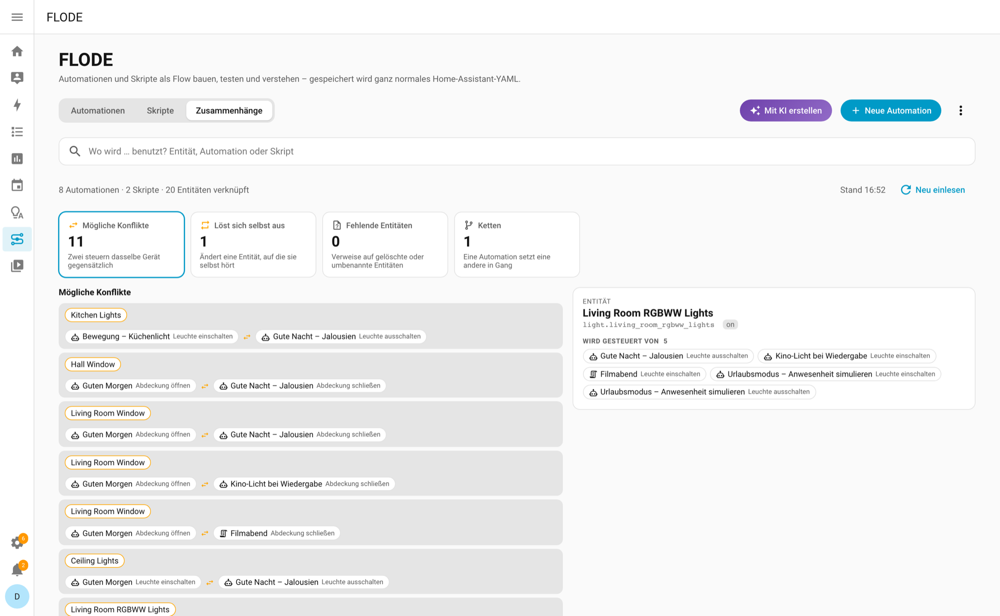</picture>
</p>

<details>
<summary>More screenshots</summary>
<br/>

<p align="center">
<picture><source media="(prefers-color-scheme: dark)" srcset="https://raw.githubusercontent.com/SH1FT-W/flode/main/docs/images/flode-home-dark.png" />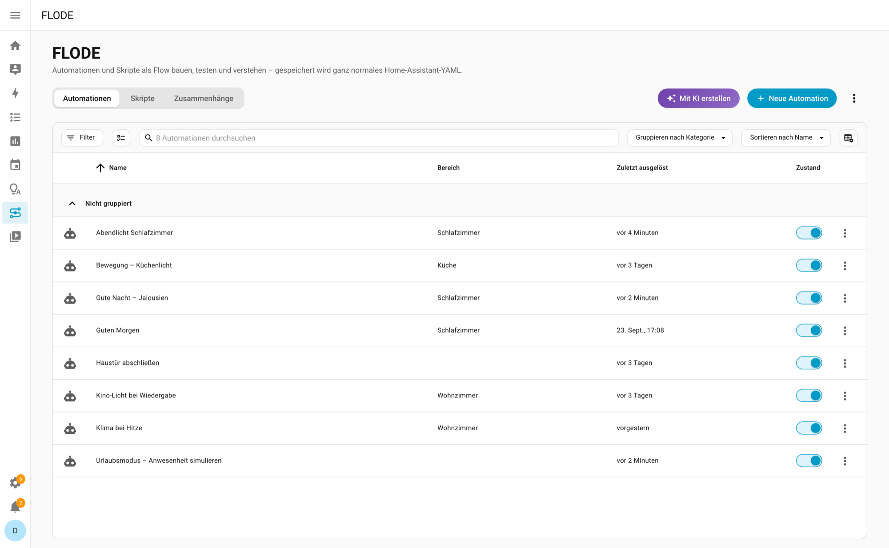</picture>
<picture><source media="(prefers-color-scheme: dark)" srcset="https://raw.githubusercontent.com/SH1FT-W/flode/main/docs/images/flode-ai-explain-dark.png" />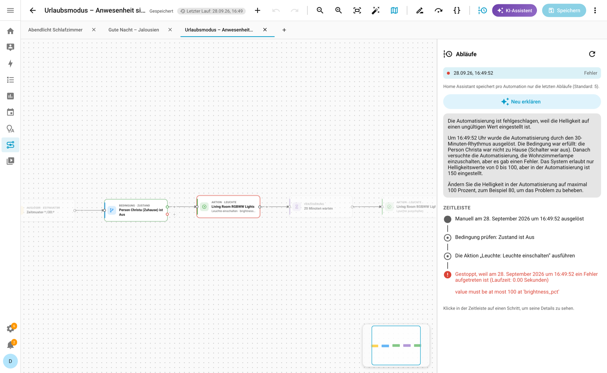</picture>
<picture><source media="(prefers-color-scheme: dark)" srcset="https://raw.githubusercontent.com/SH1FT-W/flode/main/docs/images/flode-ai-draft-dark.png" />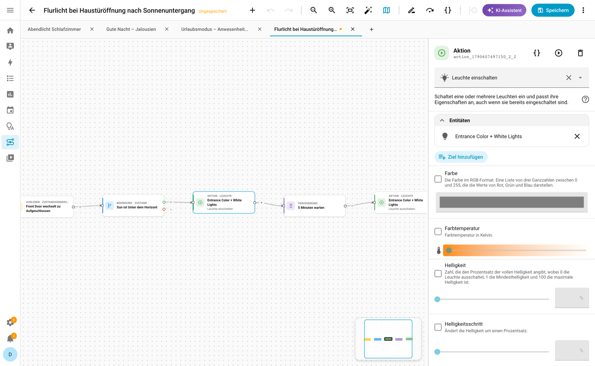</picture>
<picture><source media="(prefers-color-scheme: dark)" srcset="https://raw.githubusercontent.com/SH1FT-W/flode/main/docs/images/flode-ai-assistant-dark.png" />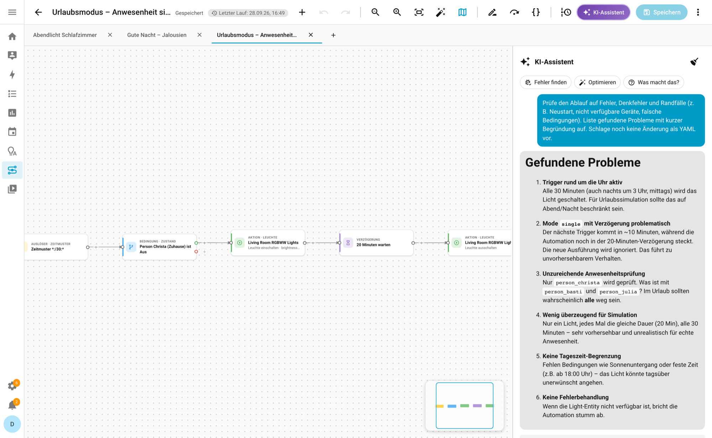</picture>
<picture><source media="(prefers-color-scheme: dark)" srcset="https://raw.githubusercontent.com/SH1FT-W/flode/main/docs/images/flode-ai-create-dark.png" />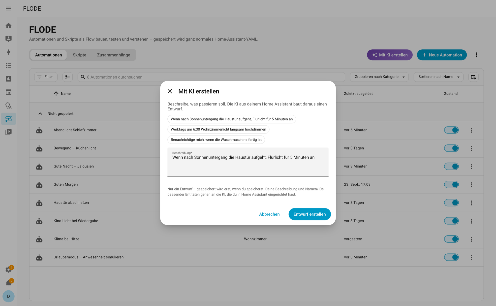</picture>
<picture><source media="(prefers-color-scheme: dark)" srcset="https://raw.githubusercontent.com/SH1FT-W/flode/main/docs/images/flode-templates-dark.png" />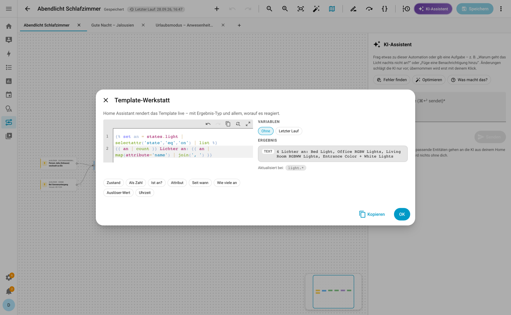</picture>
<picture><source media="(prefers-color-scheme: dark)" srcset="https://raw.githubusercontent.com/SH1FT-W/flode/main/docs/images/flode-palette-dark.png" />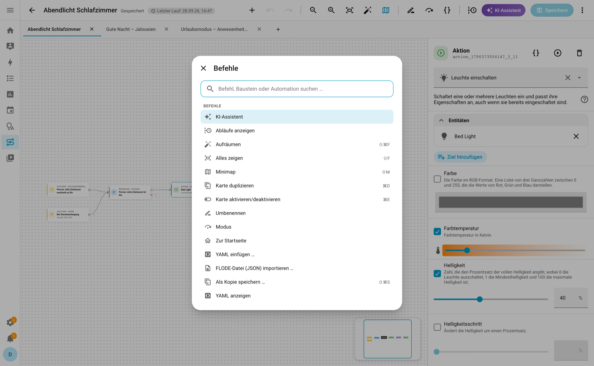</picture>
<picture><source media="(prefers-color-scheme: dark)" srcset="https://raw.githubusercontent.com/SH1FT-W/flode/main/docs/images/flode-context-menu-dark.png" />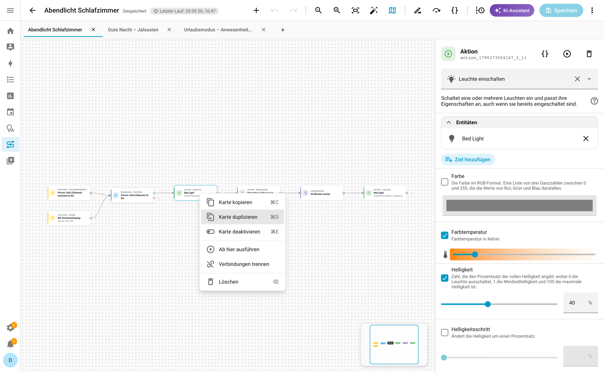</picture>
<picture><source media="(prefers-color-scheme: dark)" srcset="https://raw.githubusercontent.com/SH1FT-W/flode/main/docs/images/flode-phone-dark.png" />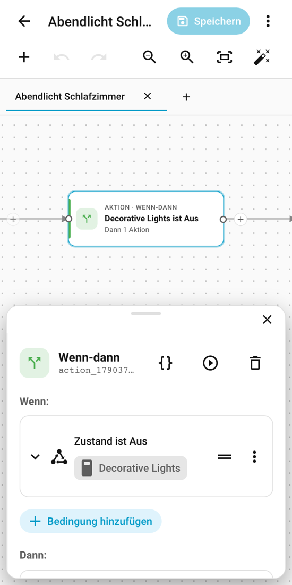</picture>
</p>

</details>

<a id="ai-help"></a>
## AI help

Optional. If you have set up an AI in Home Assistant (Anthropic, OpenAI, Google Gemini, Ollama and others) and chosen it as the default for *AI tasks*, FLODE uses it through Home Assistant's own `ai_task`. No extra key, no extra service. Without it these buttons do not appear.

- **Explain a run:** why an automation did or did not do its job, in plain words.
- **Assistant:** ask about the open flow, find mistakes, get a better version, shown first and one step to undo.
- **Create with AI:** describe what should happen and get a draft built from your real entities.

## Good to know

- FLODE never overwrites anything it was not asked to save. Back up your automations before big edits anyway.
- It warns when it cannot read part of an automation.
- FLODE follows the language and theme of your Home Assistant profile: English, German, Dutch, French, Spanish, Italian and Portuguese.
- Versions are `YY.M.N`: year, month and the number of the release in that month, without a leading "v". They count as newer than every 3.x version.

<details>
<summary>Coming from FLODE 2.x</summary>

Your automations open and save as before. FLODE 3 replaced the old editor: the simulation gave way to real runs and *Run from here*, and FLODE follows Home Assistant's language and theme instead of its own settings. Details in the [changelog](CHANGELOG.md).

</details>

<details>
<summary>How it works</summary>

How FLODE reads, draws, edits, writes and runs automations is described in [docs/architecture.md](docs/architecture.md).

</details>

<details>
<summary>Thanks</summary>

FLODE gets better with every bug report and every idea. A big thank you to:

- [**@bartbutenaers**](https://github.com/bartbutenaers): the most reports of all, from wires and branch dragging to touch and context menus, always with precise steps.
- [**@Hedda**](https://github.com/Hedda): the push to English as the main language, the Lit rebuild and the labels like Home Assistant.
- [**@srsly88**](https://github.com/srsly88): nested AND/OR conditions, the save dialog and the sidebar editor.
- [**@jlpnea**](https://github.com/jlpnea): `choose` blocks that render all the way down and `script.stop`.
- [**@NullScope**](https://github.com/NullScope), [**@pkejval**](https://github.com/pkejval): parallel steps after `scene.create` and the vertical flow.
- [**@Home-Wizz**](https://github.com/Home-Wizz), [**@JoHeyr**](https://github.com/JoHeyr), [**@oscarallo**](https://github.com/oscarallo), [**@HL-Apprentice**](https://github.com/HL-Apprentice), [**@DeKaN**](https://github.com/DeKaN), [**@Daniel-wendan**](https://github.com/Daniel-wendan), [**@bramcardon-alt**](https://github.com/bramcardon-alt), [**@dgarrison63**](https://github.com/dgarrison63): reports and ideas that made it into FLODE.

Found something or missing a feature? [Open an issue](https://github.com/SH1FT-W/flode/issues/new/choose).

</details>

## License

[Apache 2.0](LICENSE). FLODE is a fork of [C.A.F.E.](https://github.com/FezVrasta/cafe-hass) by [Federico Zivolo](https://github.com/FezVrasta).

<sub>FLODE is an independent project and is not affiliated with Home Assistant or Nabu Casa.</sub>
