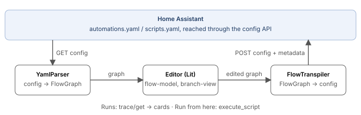
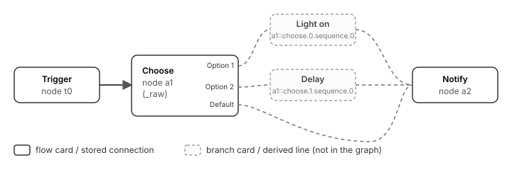

# FLODE Internals

How FLODE reads, draws, edits, writes and runs Home Assistant automations.

This document describes the inner workings of FLODE as of release 26.10.15 (October 2026). It is written for people who want to understand, question or contribute to FLODE: what the flow on the canvas really is, which parts of it are stored, how it becomes Home Assistant YAML and back, and what happens when a run is shown or started from the editor.

It is not a user manual. The README and the website cover what FLODE does; this document covers how.

**How to read it.** Sections 1 to 4 are the core: what FLODE is, how the code is organised, what the flow graph holds, and which cards and lines are stored versus merely drawn. Section 8 explains how an edit travels through the editor and section 10 how to run, test and release FLODE. Sections 5 to 7 (parser, transpiler, runs) are reference material to read when working on those parts. The appendices show complete examples.

## 1. What FLODE is, in one page

FLODE is a visual editor for Home Assistant automations and scripts. It runs as a panel inside Home Assistant and shows an automation as a flow of cards and lines. Every card is edited with Home Assistant's own editor forms, and the result is saved as a plain Home Assistant automation.

Three facts explain most of FLODE's design:

1. **Home Assistant's configuration is the only truth.** FLODE has no database and no file format of its own. An automation opened in FLODE is read from Home Assistant's config API, and saving writes a complete automation back to that API. The only thing FLODE adds is a small block of layout metadata inside the automation's `variables:`, so cards come back where the user left them.

2. **FLODE has no runtime.** It never executes anything itself. Home Assistant runs the automation, exactly as it runs any other automation. "Run from here" sends a sequence of steps to Home Assistant with the same command Home Assistant's own editor uses for "Run action". What the canvas shows about a run is read from Home Assistant's trace.

3. **The flow graph is a view on HA's step list, not a different model.** Triggers, top-level conditions and the steps of the action sequence become cards. Home Assistant's building blocks (`if`, `choose`, `repeat`, `parallel`, `sequence`) stay one card each, holding their HA step verbatim. The branches of an `if` or `choose` are drawn with their steps as cards, but those drawn cards and the lines into them are derived from the block's step and are never stored separately. This is the difference between a "flow card" and a "branch card" that section 4 explains in full.

One asymmetry follows from the third point and is worth stating once. FLODE never takes an existing block apart: whatever Home Assistant stored as an `if`, a `choose` or a `repeat` stays that block. But FLODE does translate in the other direction: when the user draws a condition card with a Yes and a No path, or several lines out of one card, or a line back to an earlier card, saving turns those shapes into an `if`, a `parallel` or a `repeat` (section 6.3). On the next open they come back as blocks with branch cards (section 4.6). The user draws with FLODE's cards; Home Assistant stores HA's blocks; FLODE shows HA's blocks.

FLODE started as a fork of C.A.F.E. (Complex Automation Flow Editor) by Federico Zivolo. The transpiler, the state machine strategy and the YAML parser come from that lineage and were reworked over several releases; the editor was rebuilt on Lit and Home Assistant's own elements in FLODE 3. Some identifiers in the code (`CafeMetadata`, the fixture names `*-cafe.yaml`, the legacy `_cafe_metadata` key) still show that origin.

## 2. Architecture

### 2.1 Packages

FLODE is a Yarn 4 workspace with four TypeScript packages and one small Python integration.

| Package | Role | Depends on |
|---|---|---|
| `@flode/shared` | The data model: Zod schemas and TypeScript types for the flow graph, HA triggers, conditions and actions, FLODE's metadata block, scripts, pass-through steps. Pure data and guards, no logic that needs HA. | zod |
| `@flode/transpiler` | Both directions between HA YAML and the flow graph: `YamlParser` (YAML → graph), `FlowTranspiler` with two strategies (graph → YAML), topology analysis, auto layout (ELK), script reshaping, "run from here" sequences. Also a small CLI. | shared, js-yaml, graphlib, elkjs |
| `@flode/ui-core` | Logic the UI needs but that has no DOM: card texts in plain language (de/en), trace path mapping, the dependency map over all automations, AI prompts and reply handling, template preview, trigger ID rules, merging automations, variable renaming in Jinja. Unit-testable without a browser. | shared, i18next |
| `@flode/frontend` | The panel: Lit web components, built with Vite into one file, `custom_components/flode/www/flode-panel.js`. Canvas, tabs, inspector, runs, palette, dialogs. Every form, picker and dialog is Home Assistant's own element. | shared, transpiler, ui-core, lit, @xyflow/system |
| `custom_components/flode` | The Home Assistant integration. It registers the panel and serves the built file. It has no API of its own and no state. | Home Assistant |

The dependency direction is strictly downward: `frontend → ui-core → transpiler → shared`. Nothing below the frontend knows about Lit, the DOM or a `hass` object; where such logic needs Home Assistant (friendly names, a websocket call), it receives a function.

### 2.2 The round trip

Everything in FLODE sits on one loop:



1. **Open.** The panel fetches the automation config (`GET config/automation/config/<id>`, or the script config). A blueprint automation first has its inputs substituted by Home Assistant (`blueprint/substitute`) and is then shown read-only.
2. **Parse.** `YamlParser` turns the config into a `FlowGraph`: cards for triggers, conditions and steps, lines between them, positions from the saved metadata or from an automatic layout.
3. **Edit.** The canvas and the inspector change the graph through pure functions (`flow-model.ts`, `branch-view.ts`). Every change is a new immutable graph; the panel keeps the undo history per tab (section 8.3).
4. **Transpile.** On save, `FlowTranspiler` validates the graph, analyses its shape and writes a complete automation config with one of two strategies, then adds `_flode_metadata` with the layout.
5. **Save.** The config goes back with `POST config/automation/config/<id>`. Home Assistant stores it in `automations.yaml` and reloads the automation. For scripts the same happens under `config/script/config/<id>`.

Because the loop always goes through Home Assistant's own config format, an automation never "belongs" to FLODE. Open it in Home Assistant's editor, edit it there, come back: FLODE reads whatever is stored. Uninstall FLODE and every automation keeps working.

### 2.3 Where the code is

| Topic | Files |
|---|---|
| Flow graph schemas | `packages/shared/src/schemas/{graph,nodes,edges,base}.ts` |
| HA step schemas, metadata block | `packages/shared/src/schemas/ha-schemas.ts` |
| Pass-through steps, internal keys | `packages/shared/src/schemas/raw-step.ts` |
| Scripts and the hidden start node | `packages/shared/src/schemas/script.ts` |
| Direction-independent geometry (`Axis`) | `packages/shared/src/axis.ts` |
| YAML → graph | `packages/transpiler/src/parser/YamlParser.ts`, `layout.ts` |
| Graph → YAML | `packages/transpiler/src/FlowTranspiler.ts`, `analyzer/topology.ts`, `strategies/{native,state-machine,steps,base}.ts` |
| Save config, scripts, run-from-here sequence | `packages/transpiler/src/{save-config,script,sequence}.ts` |
| Branch cards of if/choose, the drawn graph | `packages/frontend/src/branch-view.ts` |
| Pure edit operations and line geometry | `packages/frontend/src/flow-model.ts` |
| Node data ↔ HA editor step | `packages/frontend/src/ha-step.ts` |
| The panel: tabs, undo, save, run, card and canvas menus | `packages/frontend/src/flode-panel.ts`, `tabs.ts` |
| Canvas: cards, lines, pan/zoom, pointer input | `packages/frontend/src/flode-canvas.ts`, `hold.ts` |
| Inspector (HA's editor for the selected card) | `packages/frontend/src/flode-inspector.ts`, `ha-context.ts` |
| Command palette, shortcuts, UI strings | `packages/frontend/src/{flode-palette,shortcuts,strings}.ts` |
| Runs and traces | `packages/frontend/src/{flode-debug,trace,manual-runs}.ts`, `packages/ui-core/src/trace-mapping.ts` |
| Run from here | `packages/frontend/src/flode-runfrom.ts` |
| HA API calls | `packages/frontend/src/ha.ts` |
| Integration | `custom_components/flode/{__init__,panel,config_flow}.py` |
| Local setup, commands, release gate | `CONTRIBUTING.md`, `CLAUDE.md`, `dev/gate/README.md` |

## 3. The flow graph

The `FlowGraph` is the document the editor works on and the input of the transpiler. It is defined once, as a Zod schema in `@flode/shared`, and validated at every boundary: after parsing, before saving, when a JSON file is imported.

### 3.1 Shape

```ts
FlowGraph {
  id: string            // UUID, kept across saves (graph_id in the metadata)
  name: string          // becomes alias
  description?: string
  nodes: FlowNode[]
  edges: FlowEdge[]
  metadata?: {          // automation-level settings
    kind?: 'automation' | 'script'
    icon?: string       // scripts only
    mode: 'single' | 'restart' | 'queued' | 'parallel'
    max?, max_exceeded?, initial_state?, hide_entity?, trace?
  }
  userVariables?: Record<string, unknown>          // the automation's own variables:
  userTriggerVariables?: Record<string, unknown>   // trigger_variables:
  branchOffsets?: Record<string, {x, y}>           // moved branch cards (see 4.5)
  direction?: 'right' | 'down'                     // layout direction
  workspace?: { mode: 'merged', sources: [...] }   // merged automations only
  version: 1
}
```

### 3.2 Nodes

There are six node types. Each one's `data` is the Home Assistant step it stands for, validated by the matching HA schema, and nothing else: there is no separate "FLODE representation" of a trigger that would have to be kept in sync with HA's.

| Type | `data` | HA counterpart |
|---|---|---|
| `trigger` | an HA trigger (`trigger: state`, …) | one entry of `triggers:` |
| `condition` | an HA condition | one entry of `conditions:`, or a `- condition:` step, or the test of an `if` |
| `action` | an HA action step: service call, device action, event, `stop`, or a verbatim block | one step of `actions:` |
| `delay` | `{ delay: … }` | a `delay` step |
| `wait` | `wait_template` or `wait_for_trigger` with timeout | a `wait_*` step |
| `set_variables` | `{ variables: {…} }` | a `variables` step |

Every node has an `id`, its `type`, a `position` (canvas coordinates) and `data`. The schemas are "loose objects": keys FLODE does not know are kept, so a step from a custom integration or a newer Home Assistant survives unchanged.

The `data` can carry a few FLODE-internal marker keys that are never written to Home Assistant:

| Key | On | Meaning |
|---|---|---|
| `_raw` | action, condition, trigger | The original HA step, verbatim. See 3.4. |
| `_shorthand` | condition | Came in as a bare Jinja string (`- "{{ … }}"`) and is written back as one while it is still a plain template condition. |
| `_step` | condition | Was a `- condition:` step inside the actions, not an entry of the top-level `conditions:`. It is written back as a step as long as it has no No path; once the user connects its No output it becomes an `if` like any other condition (6.3). |
| `_chooseCase`, `_chooseCaseTotal` | condition | Legacy markers from the expanded choose chains (3.6). |

`steps.ts` strips these keys when it writes a step, and HA's editor forms never see them.

### 3.3 Edges

An edge is a directed connection between two node ids:

```ts
FlowEdge { id, source, target, sourceHandle?, targetHandle?, label?, type? }
```

`sourceHandle` matters on condition nodes only: `'true'` is the Yes output, `'false'` the No output. All other nodes have one unnamed output. Triggers have no input; the structure validator (5.5) rejects an edge into a trigger, a duplicate edge id and an edge whose endpoints do not exist. The same connection drawn twice (two ids, equal endpoints) is not rejected: the transpiler reads it as one branch. The parser hands out edge ids from source, target, handle and the time, with a counter when one is taken already (`generateEdgeId`), and makes the ids of a parsed graph unique once more before it validates (`withUniqueEdgeIds`); the editor gives new cards their id the same way (`newNodeId`).

A connection that leads back to an earlier card (a loop) is an ordinary edge with no special type; the transpiler recognises it by its place in the graph (a "back edge", 6.2), not by a marker. The optional `type` field names a few special kinds of edges that the current editor no longer creates: `hint`, `choose-chain`, `choose-hint`, `choose-default`, `choose-entry` and `loop-back` come from the expanded choose chains of FLODE 2 (3.6). The transpiler and the topology analysis still understand them and skip the visual-only ones, so old graphs stay readable.

### 3.4 Pass-through steps: `_raw`

When the parser meets a step it has no node type for (the `scene:` shorthand, a step from a newer Home Assistant, a step whose `enabled:` is a template) or one of HA's building blocks (4.1), it keeps the whole step under `_raw` in an action node, with `alias` and `enabled: false` mirrored next to it so the card can show them. The transpiler writes `_raw` back exactly as it came, except that switching the card on or off in FLODE overrides the step's `enabled`.

The same exists for conditions and triggers FLODE cannot model (a condition from a newer Home Assistant, a trigger whose `offset` is a mapping of strings HA coerces, an MQTT `payload: true`): the step is kept verbatim, with its type beside it so the card can name it, and written back unchanged instead of being replaced by something that means something else to Home Assistant. HA's editor gets the original step; what comes back from it is kept verbatim again as long as FLODE's schema does not model it.

This is how FLODE keeps the promise of never losing part of an automation it opens. A step it does not understand is still a card, still movable, still enabled or disabled, and still saved as it was.

### 3.5 The metadata block

The only thing FLODE adds to an automation is `_flode_metadata` inside `variables:`. Home Assistant treats it as an ordinary variable and ignores it.

```yaml
variables:
  _flode_metadata:
    version: 1
    graph_id: 3f2c…            # FlowGraph.id
    graph_version: 1
    strategy: native            # or state-machine
    direction: down             # only when laid out top to bottom
    nodes:                      # position of every node by id
      trigger_0: { x: 0, y: 120 }
      action_1: { x: 360, y: 120 }
    branch_offsets:             # only moved branch cards (4.5)
      "action_1::choose.0.sequence.1": { x: 0, y: -40 }
    steps:                      # which node each top-level step came from
      trigger/0: trigger_0
      action/0: action_1
```

`steps` is how a card gets its id back. While the strategies write the config, every step object is tagged with the node it came from (`tagStep` in `steps.ts`); afterwards `stepNodeIds` reads the tags off the top-level lists and records them by HA step path (`trigger/N`, `condition/N`, `action/N`; a script's conditions count as actions, because that is where its sequence keeps them). When the automation is opened again, the parser creates its nodes in the same order (triggers, top-level conditions, steps of the action list) and gives each node the id listed for its path, and with it the position stored under that id. Steps no single node stands for (an `if` of several `or`-ed conditions, a `parallel` fan-out) have no entry and take the next unclaimed id from `nodes`, in order, as every node did before `steps` existed. The strategy records the ids so that a drawn condition that became an `if` block, or a loop that became a `repeat`, hands its id and place to the block card (4.6).

If the metadata is missing (an automation written by hand or in HA's editor) or does not cover every node (changed in HA's editor since), positions are recomputed, see 5.4. The legacy key `_cafe_metadata` is read for automations saved by old versions.

The user's own variables sit next to the block and are preserved in `userVariables`.

### 3.6 Legacy: expanded blocks

Before FLODE 3, a `choose` or `if` block was taken apart into FLODE's own structure: one condition card per option, chained with `choose-chain` edges, a `choose-default` edge to the default branch, and so on. The parser still has that mode. It is what runs when `keepBlocks` is off, which the editor never does today; the CLI and a number of tests still use it. The editor opens every flow with `keepBlocks: true` (see `flode-panel.ts`, `openFlow`), so a block is one card with a `_raw` step and its branches are drawn as described in section 4.

### 3.7 Scripts and automations without triggers

A script has no triggers. FLODE still edits it as a flow, by giving it a single hidden entry: a trigger node whose `data.trigger` is `flode_script_start`, carrying the script's `fields:`. Opening a script reshapes it into an automation (`scriptToAutomationConfig`) before parsing; saving transpiles the flow as an automation and reshapes it back (`automationToScriptConfig`): the start node's fields become `fields:`, top-level conditions lead the `sequence:` as condition steps, actions follow. Parser, transpiler, layout and metadata work unchanged.

An automation without triggers (Home Assistant allows it; it runs only when started by hand or by another automation) gets the same treatment with a `flode_manual_start` node, which saving drops again. Once the user adds a real trigger, the hidden start goes away with its connections.

## 4. Flow cards and branch cards: what is stored and what is drawn

This section answers the question "which cards and lines are real, and why can I do less with some of them".

### 4.1 Blocks stay one card

Home Assistant has five step types that contain other steps: `if`, `choose`, `repeat`, `parallel` and `sequence`. FLODE treats each of them as **one card**. The card's `data` is the whole block, verbatim (`_raw`, see 3.4). Selecting the card opens Home Assistant's own editor for that block, including HA's nested editor for the steps inside. Saving writes the block back as it is.

This is the deliberate design of FLODE 3 (issue #27 and the "HA blocks stay HA blocks" rule in the project's guidelines). Taking an existing block apart into FLODE's own cards would mean owning the reverse translation for every shape HA allows, and a wrong guess silently changes what an automation does. Keeping the block whole means the user can still edit every detail (HA's editor does that) and the YAML cannot drift.

The price is that the canvas would show a `choose` with six options as a single card. For `if` and `choose`, FLODE therefore draws the branches.

### 4.2 Branch cards are drawn from the block

`branch-view.ts` derives a **BranchView** from the graph every time the graph changes (cached by graph identity). For every `if` or `choose` card it reads the block's HA step and produces:

- one **output** per branch on the block card (handles `b0`, `b1`, …): "Option 1", "Option 2", "Default" for a choose; "Then", "Else" for an if;
- one **branch card** per step inside each branch, laid out in a **lane** (a row, or a column top to bottom) that starts at the block card's output and runs along the flow, in step order;
- for a branch whose steps contain another `if`/`choose`, the same again, nested (the nested block's branches are read from the step inside the outer block's step);
- the **lines**: block output → first step of the branch → next step → … → whatever follows the block in the graph; a branch without steps runs straight to what follows;
- the flow cards after the block are **shifted** along the flow to make room, without changing their stored position.

A branch card's id names the block and the path of its step inside the block's HA step, separated by two colons:

```
action_1::choose.0.sequence.1     the 2nd step of the 1st option
action_1::else.0                  the 1st step of the else branch
action_1::choose.2.sequence.0::then.0   a step in the "then" of an if inside option 3
```

The canvas renders a branch card exactly like a flow card, with the same texts and icons, and the card menu (which lives in the panel, see 8.3) offers it almost the same entries. What differs is where its data lives.



### 4.3 What is stored and what is not

| | Flow card | Branch card |
|---|---|---|
| Exists in `graph.nodes` | yes | no |
| Lines into and out of it are `graph.edges` | yes | no, drawn from the block's step |
| Its step is stored | as the node's `data` | inside the block card's `_raw` step, at the path in its id |
| Position | `node.position`, saved in `_flode_metadata.nodes` | computed; a manual move is an offset in `branchOffsets` |
| Saved to HA as | one step of `actions:` (or `triggers:`/`conditions:`) | part of the block's step, unchanged in structure |

In short: the step cards inside an `if` or `choose` are drawings of what the block already contains. One does not need to know HA's YAML to tell them apart on the canvas: a card is a branch card exactly when it sits in a lane behind an `if` or `choose` block. Understanding why they behave differently does come down to HA's nesting, though. The block's HA step is the only truth, and FLODE only ever edits that step.

### 4.4 What works on a branch card

Every edit of a branch card is an edit of the block card's step. `branch-view.ts` has one function per operation; all of them return a new graph in which only the block card's `data` changed:

| Action on a branch card | What happens to the block's step |
|---|---|
| Select and edit in HA's form | `setBranchStep`: the step at the card's path is replaced |
| Enable/disable, rename (alias) | same, through the step's `enabled` / `alias` |
| Delete | `removeBranchStep`: the step is removed from its branch list |
| Copy | the card goes to FLODE's own clipboard (`copiedNode` in the panel); pasting onto the canvas makes a new flow card from it |
| Duplicate | a copy is inserted right after it in the same branch |
| "Disconnect" (since 26.10.11) | `detachBranchStep`: the step leaves the branch and becomes a flow card of its own at the same place, unconnected |
| Add a step via the "+" at the end of a branch | `insertBranchStep` at that index |
| Drag a connection from a branch output or branch card onto a free flow card | `adoptIntoBranch`: the card moves into the branch and stops being a flow card. A plain chain after it (cards that each have exactly one predecessor and one successor) comes along; a card something else leads to, or a chain that forks, stays |
| Drag the card | `moveBranchCard`: an offset relative to its computed place, in `branchOffsets` |
| "Run this card" | the step alone runs in Home Assistant through `execute_script` (7.3); the block's step is not changed |

And what does not work, with the reason:

- **Selecting the line into or between branch steps.** There is no edge to select, so there is nothing to delete or rewire. Since 26.10.11 these lines show no pointer cursor and open no menu. The real connections around a block are the one into the block card and the ones from the block's end to what follows; those are selectable even where they are drawn from a branch's last card, because the drawn line remembers the stored edge it stands for (4.7).
- **"Run from here" on a branch step.** Run from here walks `graph.edges` from a node (section 7.3). A branch step is not a node, so there is no start point. Running from the block card runs the whole block, which is what Home Assistant would do too. "Run this card" does work on a branch step: it needs no edges, the step is taken from the drawn graph (7.3).
- **Connecting a branch card to something else.** Its successors are fixed by the branch: the next step in the list, or the end of the block. To take a step out of the branch there is "Disconnect".
- **Steps inside `repeat`, `parallel` and `sequence` blocks** are not drawn at all. Those blocks are a single card, and their inside is edited only in HA's nested editor.

### 4.5 Moved branch cards

A branch card has no stored position. When the user drags one, FLODE stores how far it was moved from where it would otherwise be drawn, keyed by the card id, in `graph.branchOffsets`, which ends up in `_flode_metadata.branch_offsets`. Offsets follow renumbering when steps are inserted or removed before them, and offsets of steps that no longer exist are dropped on save (`withoutStaleOffsets`). If the saved layout is discarded and recomputed (5.4), the offsets go with it.

The lines to a moved branch step are routed around the cards (issues #31, #36): a step dragged left of or above its block gets a line that runs out past the block's "+", across the gap beside the cards, and back into the input.

### 4.6 What happens to a flow you draw yourself

The editor offers FLODE's own card types (3.2) as well as HA's blocks through HA's "add step" dialog. A user can therefore draw structures that Home Assistant can only store as a block:

| Drawn | Saved as (native strategy, 6.3) | Shown after reopening |
|---|---|---|
| A condition card with a Yes and a No path that meet again | an `if:` step with `then:` and `else:` | one If block card with "Then" and "Else" lanes; the former Yes/No cards are branch cards |
| A condition card with only a Yes path, in the middle of the actions | an `if:` whose `then:` holds everything after it | one If block card with everything after it as branch cards of "Then" |
| Several conditions whose Yes outputs lead to the same card | one `if:` with `condition: or` | one If block card |
| Several lines out of one card | a `parallel:` step | one Parallel card, its inside not drawn |
| A line back to an earlier card through a condition | a `repeat:` step (`while`, `until` or `count`) | one Repeat card, its inside not drawn |
| A condition card right after the triggers, Yes path only | an entry of `conditions:` | a condition card, as drawn |
| A condition card that came in as a `- condition:` step (`_step`), Yes path only | that step, unchanged | a condition card, as drawn |

So the cards a user draws do not necessarily come back as the same cards. They come back as what Home Assistant stored, drawn by the rules of section 4.2. Until the automation is reopened the editor keeps the drawn cards, and the automation behaves identically either way; the shape of the saved YAML is the same whether the user drew FLODE cards or used HA's blocks. What changes on reopening is editing: the then/else steps are branch cards with the possibilities of 4.4, and the inside of a repeat or parallel is edited in HA's nested editor. Appendix B shows a complete example.

The cards that remain keep their ids and positions through this change: the `if` block takes the id and place of the condition card it was built from, the cards after it stay where they were (`_flode_metadata.steps`, 3.5). The former Yes/No cards become branch cards and get computed positions.

### 4.7 The drawn graph

The canvas does not render `graph` directly. It renders `BranchView.graph`, a second `FlowGraph` in which the branch cards appear as nodes and the lines of the lanes as edges. This drawn graph is derived, never stored, and rebuilt from the stored graph on every change. Beside it, the view carries what the canvas needs to interpret it:

| Field | Meaning |
|---|---|
| `graph` | the drawn graph: stored nodes (block followers moved on by `shift`), branch cards as nodes, lane lines as edges. Stored edges out of a block card are replaced by one drawn line per branch end. |
| `cards` | branch card id → where it lives (`blockId`, `parentId`, `branch`, `path`, `index`) |
| `branches` | block id → its branches (`handle`, label, path, card ids) |
| `shift` | how far each stored card is drawn further along the flow than its stored position |
| `base` | where each branch card is drawn before the user's offset is added |
| `edgeOrigin` | drawn line id → the stored edge it stands for (the lines from branch ends to what follows the block) |
| `via`, `start` | extra points a line passes on its way (around other lanes, back to a moved step), and lines that begin at a block's "+" |
| `tails` | blocks nothing follows yet: where their "+" sits and which branch ends lead there |

A drawn line's id is `<stored edge id or target>::<source>::<handle>`. A line is selectable when it has an `edgeOrigin` (it stands for a stored edge) or when neither end is a branch card (it is a stored edge drawn as is); a line into or between branch steps has neither and is drawn inert (`flode-canvas.ts`, `renderEdge`). `storedPosition` and `drawnBox` in `branch-view.ts` convert between the stored and the drawn coordinates of a card; pointer input works in drawn coordinates, the graph stores stored ones.

The lane geometry (where a branch's cards sit, where its line turns, how far a block's followers move) is computed in `branch-view.ts` (`BranchLayout`, `laneAt`, `extended`). The general line shapes (the curve between two cards, the detour of a line that runs backwards, the step shape with rounded corners) are in `flow-model.ts` (`detour`, `backCrossing`, `acrossPoints`, `downPoints`) and are applied by the canvas (`renderEdge`, `detourOf`, `backPath`).

## 5. Reading Home Assistant YAML: the parser

`YamlParser.parse()` turns an automation config into a `FlowGraph`. The editor calls it on every open; the same code runs for pasted YAML, imported files and the YAML an AI reply contains.

### 5.1 Steps

1. **Load.** The YAML is parsed with js-yaml under Home Assistant's rules (`loadHaYaml` in `yaml.ts`: YAML 1.1 booleans and numbers, no timestamps, so `2026-10-01 10:00:00` stays the text it is). A list of automations is accepted; only the first one is opened, with a warning.
2. **Metadata.** `_flode_metadata` (or the legacy `_cafe_metadata`) is read from `variables:` and validated. Everything else in `variables:` becomes `userVariables`.
3. **Manual start.** An automation without triggers gets the hidden start node (3.7).
4. **State machine?** If the actions are exactly FLODE's state machine shape (a `variables` step with `current_node` and `flow_context`, then a `repeat` of `choose` entries ending on `current_node == "END"`), and either the metadata says `strategy: state-machine` or the loop condition is FLODE's exact one, the automation is read back as a graph through the dispatcher (6.4). A state machine that was changed outside FLODE (a top-level condition added, another step) is kept as ordinary steps instead, with a note, so nothing is lost.
5. **Structure.** Otherwise `parseAutomationStructure` walks the config (5.2).
6. **Positions.** From the metadata when it covers every node, else from the automatic layout (5.4).
7. **Graph.** Name, description, mode and the other automation settings are collected; the graph is validated against the schema and the structure rules (5.5). Validation errors fail the open with a message naming the node and the schema path.

The result carries `warnings` (shown as a banner above the flow) and `hadMetadata`.

### 5.2 Walking an automation

Triggers come first: every entry of `triggers:` becomes a trigger node. A trigger whose fields fail FLODE's schema becomes a fallback trigger node: a trigger card that keeps the original data unchanged, so it is written back as it was.

Top-level `conditions:` become condition nodes chained one after another on their Yes outputs: trigger → condition 1 → condition 2 → first action. That is the only shape top-level conditions can have in Home Assistant (all must pass), and the native strategy recognises exactly this chain when writing them back (6.3).

Then the action sequence. `parseActions` goes through the list; each step becomes one node, connected from the previous node (or nodes), and that node becomes the "previous" for the next step. The dispatch by step shape is:

| Step looks like | Becomes |
|---|---|
| one of `if`, `choose`, `repeat`, `parallel`, `sequence` | action node with `_raw` (the block, whole) |
| `enabled:` is a template | action node with `_raw` |
| `condition:` | condition node marked `_step`; the next step connects to its Yes output |
| `variables:` (and nothing else that makes it another step) | `set_variables` node |
| `delay:` | delay node |
| `wait_template:` / `wait_for_trigger:` | wait node; the triggers inside are validated one by one |
| `action:` / `service:`, device action, `event:`, `stop:`, `set_conversation_response:` | action node |
| anything else | action node with `_raw` (pass-through) |

Fields FLODE knows are read into the node's data; fields it does not know are kept by the loose schema. A disabled parent (`enabled: false` on a block) is inherited by its children when the expanded mode takes a block apart.

Device actions and HA's target-based triggers and conditions (`light.turned_on` and friends) are kept in their own shape so HA's forms can show them.

### 5.3 Direction

A flow is laid out left to right by default or top to bottom (issue #29). The direction is stored in the metadata and outlives a recomputed layout. All geometry in the parser, the layout, the branch view and the canvas goes through one `Axis` helper (`@flode/shared`'s `axis.ts`), which maps "along the flow" and "across the flow" to x and y, so there is one code path for both directions.

### 5.4 Layout

Saved positions are used when the metadata covers every node. (They are also checked for one tell-tale of a stale layout from the legacy expanded mode, a choose chain running backwards, and recomputed in that case; current graphs have no such chains.)

Otherwise the layout is computed with ELK (Eclipse Layout Kernel, `elkjs`) as a layered graph: cards in layers along the flow, a condition's Yes before its No so lines do not cross, fixed card sizes (260 × 92 px) unless the editor passes measured sizes (the "Tidy up" command does, so it lays cards out as they actually render).

An automation that was never opened in FLODE therefore gets a readable layout on first open, and that layout is saved with it the first time the user saves.

### 5.5 Validation

Two validations run on every graph, at parse time and again before saving:

- the **schema**: every node's `data` matches the HA schema of its type, edges have the right shape, the metadata fields are valid;
- the **structure**: no duplicate node or edge ids, every edge connects existing nodes, at least one trigger, no edge into a trigger, every edge out of a condition has a `true` or `false` handle.

The frontend turns validation errors into readable messages that name the card (`save-errors.ts`).

## 6. Writing Home Assistant YAML: the transpiler

`FlowTranspiler.transpile()` turns a `FlowGraph` into an automation config. It is the same code for saving, for the YAML view in the editor, for exporting, for "Run from here" and for the CLI.

### 6.1 Pipeline

1. **Validate** (5.5). A graph that fails is not written.
2. **Drop the superseded manual start** (3.7).
3. **Analyse the topology** (6.2).
4. **Pick a strategy**: the native one if it can handle the shape, otherwise the state machine. A caller can force one.
5. **Generate** the config. Both strategies share `steps.ts`, so a node means the same step whichever one writes it.
6. **Add `_flode_metadata`** with the positions and the strategy, next to the user's variables. (The editor's YAML view removes the block again before showing the text, so the user sees what HA's editor would show.)
7. **Serialize** with HA's YAML style (two spaces, no line wrapping, double quotes where needed).

The result carries `warnings` (for example "this flow contains cycles") that the editor shows before saving, and `strategy`. The chosen strategy is also recorded in the metadata; the editor does not announce it otherwise, but the saved automation shows it plainly in HA's editor (a state machine is a `repeat` with a `choose`).

### 6.2 Topology analysis

`analyzeTopology` in `analyzer/topology.ts` classifies the graph. Two terms it uses:

- **Entry nodes** are the nodes with no incoming edge: the triggers (and a hidden start node).
- The **level** of a node is its distance from the entry nodes in a breadth-first walk along the edges: triggers are level 0, what they lead to is level 1, and so on.

First the analysis finds **back edges** with a depth-first search from the entry nodes: an edge that leads to a node already on the current path. Back edges that touch a condition node are repeat patterns and are taken out before the rest of the analysis; a cycle made only of actions is a true cycle.

On the remaining forward edges it computes:

| Property | Meaning |
|---|---|
| `hasCycles` | a cycle not explained by a repeat pattern |
| `hasCrossLinks` | an edge that skips a level or leads to a lower level |
| `hasConvergingPaths` | a node with incoming edges from several different sources |
| `hasDivergentTriggerPaths` | different triggers lead to different first steps |

Each of them has shapes that look like the property but that Home Assistant can express natively, so they do not count:

- **Cross-links**: parallel branches of different length that converge on one node.
- **Converging paths**: all sources are triggers (every trigger leads to the same first step); several lines out of one card that meet again (a `parallel` block followed by more steps); several conditions whose Yes outputs, or whose No outputs, meet, while their other outputs are absent on all of them or meet at one node too (an `or` condition with a `then` and an `else`); the Yes and the No path of one condition, or of such an `or`, meeting again (an `if/then/else` followed by more steps).
- **Divergent trigger paths**: every trigger leads only to `condition: trigger` nodes, which test the trigger id at run time and are written as sequential `if` blocks ("trigger-id routing").

`isTree` is true when none of the four applies. Then the native strategy is used; otherwise the state machine.

### 6.3 The native strategy

`NativeStrategy` writes the automation the way a person would.

- **Triggers**: every trigger node, in order, cleaned of empty form leftovers (a `to: null` is kept, it means something).
- **Top-level conditions**: starting at the first node after the triggers, a straight chain of condition nodes that each continue through exactly one output, and that are not `_step` conditions, is promoted into `conditions:` (a No-only one as `not:`). The chain stops at the first node that is not such a condition; everything from there on is the action sequence. This matters for Home Assistant's "last triggered" bookkeeping, which only counts a run that passed the conditions.
- **The action sequence** is built by walking from the first node after the promoted conditions:
  - an action, delay, wait or variables node becomes its step (`steps.ts`);
  - a condition node that came in as a `- condition:` step (`_step`) and still has no No path is written back as that step;
  - any other condition becomes an `if:` step. Its `then:` is the walk down the Yes output, its `else:` the walk down the No output, each until the **merge point**: the first node reachable from both outputs (`findConvergencePoint`: among the nodes reachable from every branch, the one with the smallest maximum distance from the branch starts). The walk continues after the `if` from that merge point. A condition with only a Yes output has no merge point, so everything after it is nested under `then`;
  - several conditions whose Yes outputs meet at the same node become one `if` with `condition: or`; their No outputs meeting at one node become the `else` of that `or` (only the No outputs meeting: an empty `then` and that `else`). The walk continues after the `if` from the merge point of `then` and `else`. The rule is `isOrConditionGroup` in `topology.ts`, shared with the topology analysis: a No output on only some of the conditions, or No outputs leading to different nodes, is not an `or`, and the state machine writes that flow;
  - a node with several successors becomes a `parallel:` step with one branch per successor, each built until the common merge point;
  - several `condition: trigger` nodes after the triggers become sequential `if` blocks;
  - a block card (`_raw`) is written verbatim.
- **Repeats**: a back edge that touches a condition is a loop (`detectRepeatPatterns`). The back edge's shape decides the kind. The back edge ends at a condition and starts at a non-condition: `while`, the condition is tested before each pass and its No output is the exit. The back edge starts at a condition's No output: `until`, the body runs first and the condition's Yes output is the exit. The back edge starts at a condition's Yes output: `count`; the strategy then expects a `set_variables` card before the body that initialises a counter, a `set_variables` card before the condition that increments it, and reads the count from the condition's template (`< N`). A condition without such a count is written as `until` with the condition negated (the body repeats while it holds), the counter cards staying ordinary steps before and inside the loop. The body is the nodes between, and the flow continues after the loop at the exit. A `while` or `until` takes the alias of the first of its conditions that has one, a `count` the alias of the init card.
- **Automation settings**: mode, max, max_exceeded, initial_state, trace, trigger_variables and the user's variables are carried over unchanged.

For a flow that was opened from an existing automation and only moved around, the native output is the same step list in the same order with the same nesting, because every step is either one card or one verbatim block. The release gate (10.3) verifies this by saving every fixture automation after a layout-only change and comparing what Home Assistant stores with the original. For a flow drawn in FLODE, the output is the HA structure that the drawn shape means (4.6).

### 6.4 The state machine strategy

A flow whose shape Home Assistant's nesting cannot express, for example a step with two incoming connections from different branches that are not a `parallel` fan-out, or a loop that jumps back into the middle of a sequence, is written as a **state machine**. The idea is a tiny virtual CPU inside one `repeat` step:

```yaml
actions:
  - variables:
      current_node: "action_1"        # program counter (a template if triggers differ)
      flow_context: {}
  - alias: State Machine Loop
    repeat:
      until: "{{ current_node == \"END\" }}"
      sequence:
        - choose:
            - conditions: "{{ current_node == \"action_1\" }}"
              sequence:
                - action: light.turn_on          # the node's own step
                  target: { entity_id: light.x }
                - variables: { current_node: "condition_2" }   # the edge
            - conditions: "{{ current_node == \"condition_2\" }}"
              sequence:
                - if: [{ condition: state, … }]
                  then: [{ variables: { current_node: "action_3" } }]
                  else: [{ variables: { current_node: "END" } }]
            # … one entry per node
          default:
            - action: system_log.write
              data: { message: "FLODE: Unknown state …", level: warning }
            - variables: { current_node: "END" }
```

Each non-trigger node is one `choose` entry: its step, then a `variables` step that sets `current_node` to the next node (a condition sets it in `then`/`else`). Triggers that lead to different first nodes get a Jinja template on `trigger.idx` as the initial `current_node`. A node with several successors inlines them as a `parallel:` tail, as far as nothing outside those branches reaches into them (otherwise FLODE warns and keeps separate entries). The `default` entry catches an unknown state and ends the loop. `flow_context` is always written as an empty mapping; it is a reserved slot from the C.A.F.E. format that nothing reads today, and the parser uses it only to recognise the shape.

The parser reads this shape back into the same graph (5.1 step 4): node ids come from the `current_node` templates, edges from the transitions. The metadata marks the automation with `strategy: state-machine`.

When does a user meet it? Rarely. Almost every automation is a tree and gets the native output. The state machine appears when a drawn shape has no HA nesting, for example two triggers that lead to different first steps and then meet (Appendix C), or a cycle without a condition. FLODE does not rewrite such a flow into a native form on its own (it could insert trigger-id conditions, but that changes the flow the user drew); it writes the state machine and warns about cycles. In HA's editor the result is readable as a `repeat` with a `choose`, but not pretty.

### 6.5 Loops and infinite loops

FLODE executes nothing, so the question "what happens with an infinite loop" is a question about what FLODE writes and what Home Assistant then does.

- **A loop through a condition** (native) becomes a `repeat` with `while`, `until` or `count`. Home Assistant evaluates the condition on every pass. FLODE adds no counter and no time limit of its own; whether the loop ends depends on the condition.
- **A cycle without a condition**, or one the native strategy cannot shape, becomes a state machine (6.4). The `repeat … until current_node == "END"` runs as long as the transitions keep pointing at nodes. When the flow is saved, FLODE warns: "This flow contains cycles but no conditions. This could result in an infinite loop", or the milder note that the conditions must eventually break the cycle.
- **At run time** Home Assistant is in charge. A `repeat` loop runs inside the automation's run; with `mode: single` (the default) a new trigger while it runs is ignored and logged, with `restart` it cancels the running loop. Home Assistant's script engine also protects itself: a `repeat` loop logs a warning after 5 000 iterations and terminates the loop after 10 000 (`REPEAT_WARN_ITERATIONS` and `REPEAT_TERMINATE_ITERATIONS` in `homeassistant/helpers/script.py`). Reloading or disabling the automation stops a running loop at the next step.

FLODE does not try to detect at edit time whether a condition can become false; that depends on entity states and is not decidable from the flow. What it can do, it does: a cycle with no condition at all is flagged before saving.

### 6.6 Writing one step

`strategies/steps.ts` is the single place where a node becomes a Home Assistant step. Highlights:

- A service call is written as `action:` (the current key), with `target`, `data` (kept as a template string when it is one), `response_variable`, `continue_on_error`. The old `service:` key is read but not written. A node's `id` is dropped: HA's action steps do not take one.
- A device action keeps `device_id`, `domain`, `type`, `entity_id`, `subtype` first, as HA's editor writes them.
- A condition is written with `condition` first, FLODE's internal keys and empty form fields removed, nested `and`/`or`/`not` conditions converted the same way, a one-item `id` list collapsed to a string.
- A pass-through step (`_raw`) is returned as it came, with the card's own enabled switch applied.

## 7. Runs, traces and "Run from here"

### 7.1 Runs of a saved automation

Home Assistant records a trace for every run of an automation or script. The Runs panel (`flode-debug.ts`) lists them with `trace/list` and loads one with `trace/get`. The whole trace object goes into Home Assistant's own trace elements (the timeline), so FLODE shows exactly what HA's trace view shows. The logbook entries of the run are fetched by context id with `logbook/get_events`.

### 7.2 Mapping a trace onto the cards

A trace is keyed by **step paths** such as `trigger/0`, `condition/1`, `action/2`, `action/0/then/1`, `action/3/choose/1/sequence/0`. `createTracePathResolver` in `ui-core` maps each path to a card by walking the graph the same way the native strategy lays it out: which conditions were promoted to `conditions:`, which condition became an `if` with nested `then`/`else`, where two branches meet again. A step inside a block card resolves to that card, and `branchCardForPath` additionally finds the branch card for a step inside an `if` or `choose` lane. The canvas then marks every card the run touched: done, failed (a condition that was false) or error.

Traces of older runs may belong to a different version of the automation. `configShape` reduces a config to its layout (how many triggers, conditions and steps, of which kind, nested how) so that a run is only drawn on the cards when its shape still matches; otherwise the timeline is shown without the marks.

Scripts record `sequence/N`; FLODE maps that onto `action/N` because it lays scripts out like automations.

Shapes the resolver does not follow (the inside of a `repeat`, a `parallel` fan-out, trigger-id routing, a state machine) resolve to the containing card or to nothing; those steps count as unmapped and the timeline still shows them.

### 7.3 Run from here

"Run from here" on a card runs that card and everything after it, for real, in Home Assistant. There is no simulation. It can be started from three places: the card's menu (`renderCanvasMenu` in the panel), the command palette (⌘K), and the play button in the inspector; all three set `runFromId` on the panel, which opens the `flode-runfrom` dialog.

1. `buildSequenceFlow` cuts the sub-graph: everything reachable from the chosen node along `graph.edges` (loops included, and on past any merge point), minus the triggers, with one synthetic trigger in front. Choosing a trigger means "everything after this trigger", that is, the targets of that trigger's own edges; other triggers play no part.
2. `transpileSequence` runs the normal transpiler on that sub-flow and unwraps the result into a flat action list: the flow's own variables (`userVariables`, plus a state machine's variables if one was needed) as a leading `variables` step, the automation's top-level conditions as condition steps (a false one stops the sequence, as in an automation), then the actions. The metadata block is not part of it. The same strategies apply, so a sub-flow with a loop becomes a `repeat` or a state machine.
3. The dialog shows how many steps will run. If any step reads `trigger.…`, FLODE borrows the `trigger` variable from the automation's last trace, says when that run was, and passes it as `variables`; without a previous run it warns that `trigger` will be empty.
4. On confirmation the panel calls the websocket command `execute_script` with the sequence, the same command Home Assistant's editor uses for "Run action". The call returns when the sequence has finished, delays included.
5. Home Assistant keeps no trace for `execute_script`, so FLODE lists these runs itself under Runs (`manual-runs.ts`): status, the cards that ran (marked on the canvas), and the logbook entries that carry the run's context id, polled a few times because the logbook is written with a short delay.

**Run this card** (since 26.10.15) is the same machinery with the scope `only`: `buildSequenceFlow` keeps just the chosen card behind the synthetic trigger, so the sequence is that one step (a condition card becomes a single condition step; a trigger has no step and gets no entry). It is offered in the same three places. On a branch card it works too, where "Run from here" cannot: the panel hands the dialog the drawn graph (4.7), in which the branch card is a node with its step, and the scope `only` needs no edges. The run is listed under Runs like any manual run, with only that card marked.

## 8. The editor

### 8.1 Building blocks

The frontend is a set of Lit web components, one per file, that render into Home Assistant's own theme. There is no design system of FLODE's own: every form, dialog, dropdown, picker and menu is a Home Assistant element (`ha-dialog`, `ha-dropdown`, `ha-icon`, `ha-code-editor`, …), and every card is edited with `ha-automation-trigger-editor`, `ha-automation-condition-editor` or `ha-automation-action-editor`, the exact editors of Home Assistant's automation page. FLODE loads them from Home Assistant at run time: the panel asks HA's frontend to load its automation editor bundle and waits until the elements are defined before it renders an inspector. The minimum HA version in `hacs.json` (2026.3) is the oldest one whose internals FLODE has been checked against.

HA's editors talk to their surroundings through Lit contexts (trigger descriptions, the automation's triggers for trigger ids, …). `ha-context.ts` answers those context requests for the HA elements rendered inside FLODE, so the forms behave as they do in HA's page.

`ha-step.ts` is the bridge between a node's `data` and the step an HA editor expects and emits (`nodeToStep`, `stepToNode`). It mirrors `steps.ts` in the transpiler so that what the user edits is what gets saved. For a branch card the same bridge works on the step at the card's path inside the block.

### 8.2 The panel

`flode-panel.ts` is the root element. It owns:

- the **open flows**, one per tab, each with its graph, its save state, its undo history and its viewport (`tabs.ts` holds the tab model and remembers open tabs across a page reload);
- the **menus**: the card menu, the connection menu and the canvas menu are one HA menu rendered by the panel (`renderCanvasMenu`); the canvas only reports where and on what the user clicked or held;
- **saving** (`writeFlow`, section 2.2 steps 4 and 5): validate, check for a conflict, transpile, POST. Before writing, FLODE compares a fingerprint of the stored config with the one it opened or last saved (`configFingerprint`). A different fingerprint means the automation was changed in HA meanwhile, and the user chooses between loading HA's version and overwriting it. Blueprint automations are never written;
- the **Runs** panel, "Run from here", the assistant, the command palette (⌘K), the template workshop (⌘J), import/export and merging;
- the list of automations and scripts, read from the entity registry and HA's config API.

### 8.3 How an edit becomes a new graph

Every change follows the same path, which is the first thing to know before touching the editor:

1. A pointer event (drag, click, hold, drop) arrives in `flode-canvas.ts`, or a form change arrives from HA's editor in `flode-inspector.ts`, or a menu entry runs in the panel.
2. The element turns it into a call of a pure function: an operation from `flow-model.ts` for flow cards and edges (`connect`, `insertBetween`, `removeNode`, `duplicateNode`, `disconnectNode`, `toggleNodeEnabled`, `moveNode`, …) or from `branch-view.ts` for branch cards (4.4). Each returns a new `FlowGraph`; nothing is mutated.
3. The canvas emits `graph-change` with the new graph; the inspector emits the edited step; the panel's own handlers call `commit` directly.
4. `commit(next, editKey?)` in the panel pushes the previous graph onto the undo stack (`past`, at most 100 steps), clears `future`, replaces the tab's graph and marks it unsaved. Edits that name the same `editKey` within one second (typing in a card's form) continue the previous undo step instead of starting a new one (`continuesStep`, `HISTORY_COALESCE_MS`).
5. The new graph flows down as a property; `cachedBranchView` derives the drawn graph (4.7); the canvas re-renders.

Because the rules are pure functions, they are unit-tested without a DOM, and the transpiler receives exactly what the tests see. Pointer handling worth knowing: a touch "hold" is measured by FLODE itself (`hold.ts`, 500 ms without moving), because iOS reports no long press (#32); a connection is still hit when the hand moves a pixel between press and release (#34); dragging from a branch output onto a free card pulls it into the branch (#36).

### 8.4 Canvas

`flode-canvas.ts` draws the cards as HTML and the lines as SVG, with pan and zoom from `@xyflow/system`, the framework-free core React Flow is built on. It owns no document state: it receives the stored graph, derives the drawn graph, and emits `graph-change`, `select` and `canvas-menu`. Three zoom levels change what a card shows (full text, icon and title, icon only). Pointer input is in drawn coordinates; before a move or a connection is committed it is translated back to stored ones (4.7).

### 8.5 Card texts

Cards describe their step in plain language ("Bed light changes to On" rather than `light.bed_light / to: on`). `node-summary.ts` in `ui-core` builds these texts from the step data with i18next locales (de, en); everything that needs Home Assistant (friendly names, units, state translations, number and time formats) comes in through a context object. The setting "Card text like Home Assistant" instead asks HA's own describe functions for the text. UI strings of the panel itself live in `strings.ts` (de and en); keyboard shortcuts and their hints in `shortcuts.ts`.

### 8.6 The rest of the toolbox

- **Template workshop**: Jinja in HA's code editor, rendered live by Home Assistant through the `render_template` subscription, with the result type, what the template listens to, and optionally the variables of a real run.
- **AI assistant and drafts**: built on Home Assistant's `ai_task.generate_data`, which uses whatever model the user configured in HA. FLODE never talks to an AI provider itself. A reply is parsed like any YAML; a proposed change is a preview until "Apply", then one undo step. Nothing is saved automatically.
- **Relations (dependency map)**: works on the raw configs of all automations and scripts, not on FLODE graphs, so it also covers automations never opened in FLODE. It finds what each one listens to, checks and controls, which set each other off, conflicting controls of one entity, and references to entities that no longer exist.
- **Merging automations**: several automations become one flow with prefixed node ids; clashing variable names inside Jinja templates are renamed with a tokenizer that only touches identifiers inside `{{ }}` and ``.
- **Import and export**: HA YAML or a FLODE JSON file opens as a new draft; the YAML view shows what saving would write, without the metadata block.

## 9. The Home Assistant integration

The Python side is deliberately tiny (about 150 lines):

- `config_flow.py`: a single config entry, created from the UI with no options.
- `panel.py`: on setup it checks that the built `flode-panel.js` exists (a missing build fails the setup with a clear message instead of retrying), registers the `www` folder as a static path once per Home Assistant run, and registers a custom panel with `require_admin=True`. The module URL carries a timestamp so an update is picked up without clearing the browser cache.
- `__init__.py`: sets up and unloads the panel.
- `diagnostics.py`: the version and nothing personal.

There is no backend logic, no websocket command of FLODE's own and no storage. Everything the panel needs comes from Home Assistant's existing APIs:

| Purpose | API |
|---|---|
| Read and write an automation or script | REST `config/automation/config/<id>`, `config/script/config/<id>` |
| List, rename, relabel | websocket `config/entity_registry/*` |
| Blueprint automations | `blueprint/substitute` |
| Runs | `trace/list`, `trace/get`, `logbook/get_events` |
| Run from here | `execute_script` |
| Template workshop | `render_template` subscription |
| AI | `ai_task.generate_data` |
| HA's editor elements and translations | loaded from the running frontend |

This is also why FLODE needs no update for a new Home Assistant release as long as these APIs and the editor elements stay compatible, and why a change in HA's frontend internals is the usual reason for a FLODE fix.

## 10. Working on FLODE

### 10.1 Running it locally

FLODE runs only inside Home Assistant; there is no standalone dev server. The setup is described in `CONTRIBUTING.md`: `yarn install`, then `yarn dev`, which rebuilds the panel into `custom_components/flode/www` on every change. That folder is mounted or copied into a test Home Assistant (a Docker instance works well); reloading the browser picks up the new build. `yarn build:ha` builds everything once; `yarn test`, `yarn typecheck` and `yarn lint:biome` are the checks. The coding rules (strict TypeScript, no `any` or `as`, HA's own elements, no duplicated logic, no IIFEs) are in `CLAUDE.md` and `CONTRIBUTING.md`.

### 10.2 Tests

Vitest runs the unit tests of all four packages (at the time of writing 69 test files: 36 in the transpiler, 17 in the frontend, 12 in ui-core, 4 in shared). They cover round trips of YAML fixtures, topology cases, both strategies, parser edge cases, the flow model, the branch view, trace mapping onto cards and the tab model. Frontend tests build graphs as plain objects and call the pure functions; a branch view test, for example, constructs a graph with a `_raw` choose step and asserts on `branchView(graph)`.

The fixtures in `__tests__/yaml-automation-fixtures` (39 at the time of writing) are real-world automations, including state machine ones from the C.A.F.E. days; `dev/gate/flows/` holds more, written for one pattern each (an `or` in the middle of a flow, a `parallel` with conditions, a trigger FLODE keeps verbatim, a script with `fields` …). Two invariants are checked over all of them:

- the graph invariant: parse the YAML, transpile the graph, parse the result again, and the graph is the same (`yaml-roundtrip.test.ts`, with snapshots of the output);
- the hard rule (`fixtures-structural-roundtrip.test.ts`): opened as the editor opens it (`keepBlocks`) and saved as the editor saves it (`buildAutomationSaveConfig`, `transpileScript`), every fixture comes back as the **same Home Assistant config**, and a second save changes nothing more. "Same" is defined once, in `ha-equal.ts`: key order never counts; HA's own key migration (`platform` → `trigger`, `service` → `action`, singular → plural top-level lists) is applied to both sides; `id`, FLODE's metadata block and an empty `variables:` are not part of the automation; `mode: single`, an empty top-level list and empty `data: {}` count as not set; `null` is a value (`to: null` means something). FLODE's node keys `_raw` and `_step` must never appear in a saved config. The rare wanted difference (a C.A.F.E. state machine that FLODE unwraps into native steps) is listed in the test with its reason, and the test fails when a listed fixture round-trips cleanly again, so the list cannot go stale. The release gate (10.3) compares with the same definition.

### 10.3 The release gate

No release goes out without a green run of `dev/gate/gate.sh` for exactly the commit that is released. The gate takes about three minutes and runs, in order:

1. **static**: Biome, type check, all unit tests, build;
2. **test HA**: copies the build into a Docker Home Assistant, restarts it, and loads every fixture that HA itself accepts plus a few gate flows (automations kept in `dev/gate/flows/` for the browser checks);
3. **cards** (Chromium and WebKit): opens every automation like a user and checks for console errors, unexpected reloads, warnings about unread parts, and broken card texts;
4. **roundtrip**: moves one card in every automation, saves, and compares what Home Assistant stores with the original, apart from the metadata block and HA's own key migrations. Accepted differences are listed with a reason in `known.json`. This is the second invariant, stronger than the unit tests' one: not only the graph but the YAML Home Assistant stores must come back unchanged;
5. **actions**: select, duplicate, undo, redo, disable, tidy up, minimap, branch cards, add a step through HA's dialog and save, the runs view, a phone-sized window, the "What's new" sheet;
6. **visual**: screenshots of typical automations in both browsers, compared with the last release; differences are shown to a person, never failed automatically.

`gate.sh --only <step>` runs one step while working on something; only the full run counts for a release.

### 10.4 Releases and versions

Since October 2026 FLODE uses calendar versions `YY.M.N` (year, month, number of the release in that month), for example `26.10.14`; `dev/next-version` prints the next one. They sort after every 3.x version, so updates through HACS continue to work. A release means: update the "What's new" sheet (`flode-welcome.ts` and its strings), bump the version in `custom_components/flode/manifest.json` and `packages/frontend/package.json`, commit, run the gate, tag with the bare version number, push, and create the GitHub release with notes compiled from the commits. The full checklist is in `CLAUDE.md`.

## 11. Glossary

| Term | Meaning |
|---|---|
| **Flow, flow graph** | The `FlowGraph`: nodes, edges and settings of one automation or script. Also "the stored graph", as opposed to the drawn graph. |
| **Card, node** | A node of the graph as drawn. "Card" is the user's word, "node" the code's. |
| **Connection, edge** | A stored link from one node's output to another node's input. |
| **Flow card** | A card that is a node of the graph, as opposed to a branch card. |
| **Block, block card** | A card holding one of HA's building blocks (`if`, `choose`, `repeat`, `parallel`, `sequence`) verbatim. |
| **Branch, branch card** | A branch is one option of an `if`/`choose`; a branch card is a step inside it, drawn from the block, not stored as a node. |
| **Lane** | The row (or column, top to bottom) in which a branch's cards are drawn behind the block. |
| **Drawn graph** | The `BranchView.graph` the canvas renders: stored cards plus branch cards and lane lines. Derived, never stored. |
| **Pass-through step, `_raw`** | A step kept verbatim because FLODE has no card type for it (or because it is a block). |
| **Entry node** | A node with no incoming edge: a trigger or a hidden start node. |
| **Level** | A node's distance from the entry nodes, breadth-first. |
| **Back edge** | An edge to a node already on the current path; a loop. |
| **Merge point** | The first node reachable from all branches of a condition or fan-out; where the flow continues after an `if` or `parallel`. |
| **Topology analysis** | The classification (cycles, cross-links, converging paths, divergent triggers) that picks the strategy. |
| **Native strategy** | Writes nested HA YAML: `conditions:`, `if/then/else`, `parallel`, `repeat`. Used for tree-shaped flows, which is nearly all of them. |
| **State machine strategy** | Writes a `repeat` with a `choose` dispatcher and a `current_node` variable. Used for shapes HA's nesting cannot express. |
| **Trigger-id routing** | `condition: trigger` nodes after the triggers that pick a path by which trigger fired; written as sequential `if` blocks. |
| **Metadata block** | `_flode_metadata` in `variables:`: positions, branch offsets, direction, graph id, strategy. |
| **Manual start, script start** | The hidden entry node of a script or of an automation without triggers. |
| **Trace, step path** | HA's record of a run, keyed by paths such as `action/0/then/1`. |
| **Run from here** | Executes a card and everything after it through HA's `execute_script`. |
| **Gate, gate flows** | The release check in `dev/gate`, and the automations it loads into the test HA for its browser checks. |
| **C.A.F.E.** | Complex Automation Flow Editor, the project FLODE was forked from. |

## Appendix A. An existing automation, opened and saved

The automation as Home Assistant stores it:

```yaml
alias: Hallway light
triggers:
  - trigger: state
    entity_id: binary_sensor.hallway_motion
    to: "on"
conditions:
  - condition: numeric_state
    entity_id: sensor.hallway_lux
    below: 20
actions:
  - action: light.turn_on
    target: { entity_id: light.hallway }
  - delay: "00:02:00"
  - if:
      - condition: state
        entity_id: binary_sensor.hallway_motion
        state: "off"
    then:
      - action: light.turn_off
        target: { entity_id: light.hallway }
mode: single
```

What the parser makes of it (ids shortened):

```
nodes
  t0  trigger        state binary_sensor.hallway_motion → on
  c1  condition      numeric_state sensor.hallway_lux below 20
  a2  action         light.turn_on light.hallway
  d3  delay          00:02:00
  a4  action (_raw)  the whole `if` block

edges
  t0 → c1
  c1 --true--> a2
  a2 → d3
  d3 → a4
```

On the canvas, `a4` is drawn as an "If" card with two outputs. "Then" has one branch card, `a4::then.0` (light.turn_off); "Else" is empty and runs straight to the end. Neither the branch card nor the lines around it are in the graph.

Saving: the topology is a tree, so the native strategy writes `t0` as the trigger, promotes `c1` into `conditions:` (one output, right after the trigger, not a `_step`), writes `a2`, `d3` and the `if` block verbatim, and adds the metadata:

```yaml
variables:
  _flode_metadata:
    version: 1
    graph_id: …
    graph_version: 1
    strategy: native
    nodes:
      t0: { x: 0, y: 0 }
      c1: { x: 360, y: 0 }
      a2: { x: 720, y: 0 }
      d3: { x: 1080, y: 0 }
      a4: { x: 1440, y: 0 }
```

Apart from that block the stored automation is the one above. If the user had edited the `light.turn_off` step on the branch card, only the `if` block's step would have changed, and it would still be written as one `if`.

## Appendix B. A flow drawn in FLODE, saved and reopened

The user draws five cards: a trigger, a condition card, an action on its Yes output, another action on its No output, and a notification that both actions lead to.

```
t  trigger    binary_sensor.m → on
c  condition  light.y is on
a  action     light.turn_on light.x         (Yes path)
b  action     light.turn_off light.x        (No path)
n  action     notify.notify "done"

t → c,  c --true--> a,  c --false--> b,  a → n,  b → n
```

The topology analysis sees the Yes and No path of one condition meeting again at `n`, which is the if/then/else exception, so the flow is a tree. The native strategy writes:

```yaml
triggers:
  - trigger: state
    entity_id: binary_sensor.m
    to: "on"
actions:
  - if:
      - condition: state
        entity_id: light.y
        state: "on"
    then:
      - action: light.turn_on
        target: { entity_id: light.x }
    else:
      - action: light.turn_off
        target: { entity_id: light.x }
  - action: notify.notify
    data: { message: done }
mode: single
variables:
  _flode_metadata:
    nodes: { t: …, c: …, a: …, b: …, n: … }   # five positions
    steps: { trigger/0: t, action/0: c, action/1: n }
    strategy: native
```

The condition `c` was not promoted into `conditions:` because it has a No path. The merge point of its two outputs is `n`, so the `if` ends there and `n` follows it. The `if` step is recorded as coming from `c`.

Reopened, the automation has **three** cards: the trigger, one If block card (the `if` step, verbatim, `_raw`) and the notification. The former `a` and `b` are now branch cards in the block's "Then" and "Else" lanes, with the possibilities of section 4.4; "Run from here" is available on the block, not on them. The trigger keeps `t`, the block card gets `c` and its position, the notification keeps `n` and its position. The automation itself is the same automation, before and after; only how FLODE lets the user edit the then/else steps has changed.

## Appendix C. A shape that needs the state machine

Two actions `A` and `B` that both lead to a third action `C`, where `A` follows trigger 1 and `B` follows trigger 2:

```
trigger 1  →  A  →  C
trigger 2  →  B  →  C        (one card C with two incoming connections)
```

Home Assistant runs every trigger through the same action list, so there is no nesting that says "A for trigger 1, B for trigger 2, then C for both" without a trigger-id condition. The topology analysis reports divergent trigger paths and converging paths; the state machine writes:

```yaml
actions:
  - variables:
      current_node: "{{ 'A' if trigger.idx == '0' else 'B' }}"
      flow_context: {}
  - alias: State Machine Loop
    repeat:
      until: "{{ current_node == \"END\" }}"
      sequence:
        - choose:
            - conditions: "{{ current_node == \"A\" }}"
              sequence: [ <A's step>, { variables: { current_node: "C" } } ]
            - conditions: "{{ current_node == \"B\" }}"
              sequence: [ <B's step>, { variables: { current_node: "C" } } ]
            - conditions: "{{ current_node == \"C\" }}"
              sequence: [ <C's step>, { variables: { current_node: "END" } } ]
          default: [ …log…, { variables: { current_node: "END" } } ]
```

The same flow drawn with a "Triggered by" condition (`condition: trigger`) after each trigger instead stays native: two sequential `if` blocks, then `C`. FLODE leaves that choice to the user.
